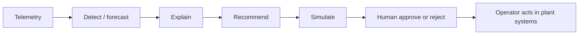

# Advisory loop

Current release: **Detect → Explain → Recommend**.

Target loop after pilot validation: **Predict → Optimise → Simulate → Human approve**.

- `POST /v1/optimisation` returns an advisory dispatch plan.
- `POST /v1/simulate` wraps the same planner with `plantExecution: false` and `humanApprovalRequired: true`.
- Recommendation status is `PROPOSED → ACKNOWLEDGED → APPROVED | REJECTED`.
- Hardware execution is hard-coded off (`ZOLT_ADVISORY_ONLY=true`). Automatic plant execution stays outside this release.
